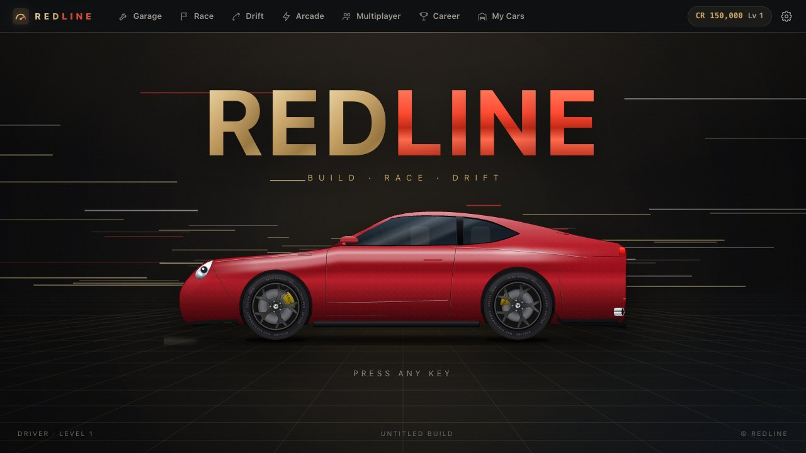
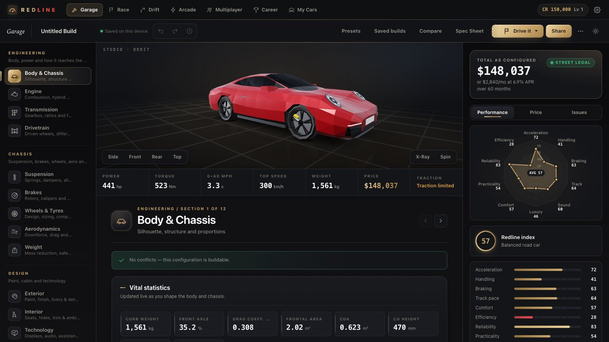
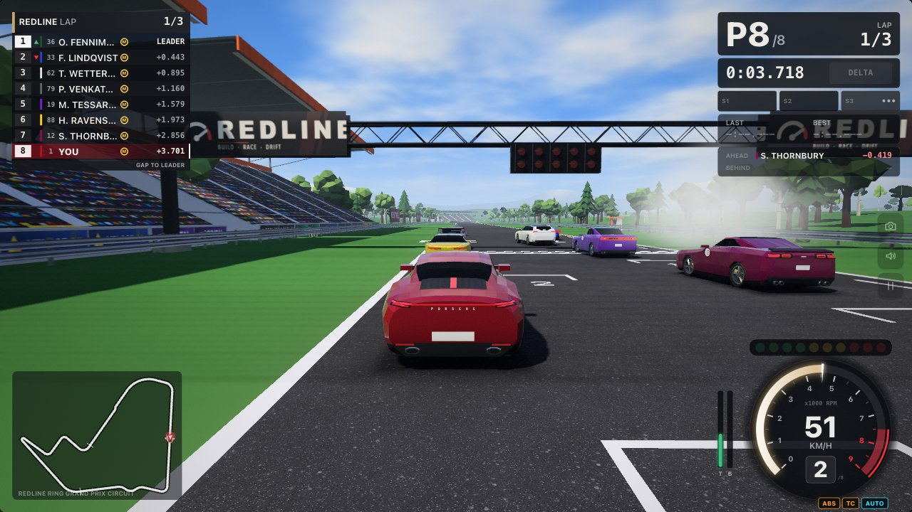
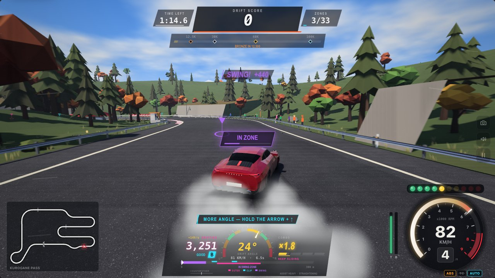
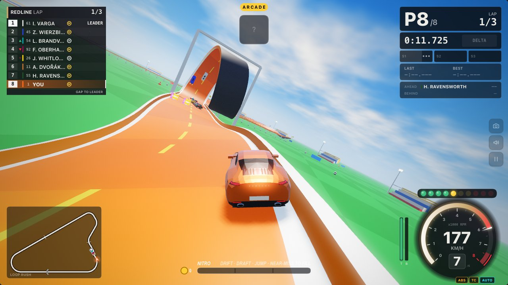
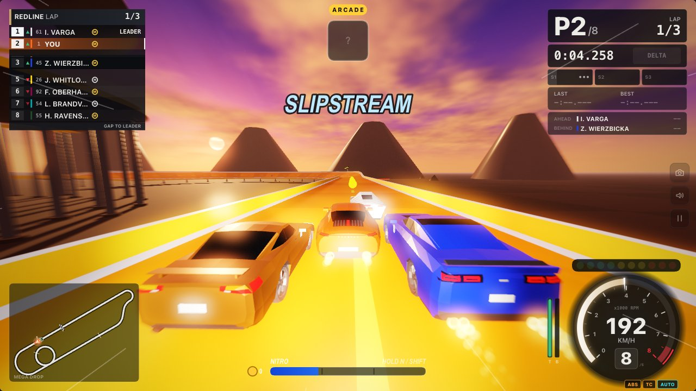
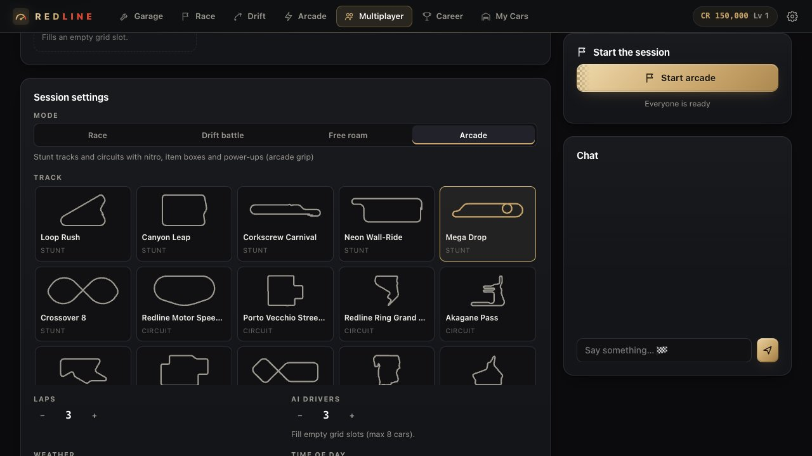

# Redline

**Build a real car, then race it, drift it and fly it through stunt loops, all in the browser, with zero dependencies.**

**Play it: https://squarejumper.com/RacingGame/**

Redline is one game with one UI. You build a car in the Garage, then race it, drift it, take it into Arcade stunt tracks with nitro and items, run a career, or play online with friends. Everything runs from `index.html`: plain classic scripts, a hand-written WebGL renderer, no npm packages and no build step.

| | |
|---|---|
|  |  |
|  |  |
|  |  |
|  | |

## Highlights

- **Garage**: 53 real manufacturer models (Porsche 911, GR Yaris, AE86, Ferrari SF90, F-150 Raptor, VW ID. Buzz …) drawn as low-poly renderings, with 12 tuning sections, live physics, pricing, a rules check and share links.
- **Race**: 3D circuit racing on 10 tracks against an AI field (Grand Prix, Time Trial, Practice), with weather and time of day.
- **Drift**: score attack, free run and tandem on dedicated drift venues, with steering assists from Off to Auto.
- **Arcade**: arcade grip, nitro, Mario-Kart style item boxes (turbo, oil, shockwave, rockets, shield, magnet, ghost, lightning …) and coins, on 6 stunt tracks with loops, jumps, wall rides and corkscrews, plus every circuit.
- **Arcade** (`#/arcade`): every car on a forgiving arcade grip model, with nitro (filled by drifting, drafting, jumps and near misses), item boxes and coins. Six stunt tracks (Loop Rush, Canyon Leap, Corkscrew Carnival, Neon Wall-Ride, Mega Drop, Crossover 8) plus all the circuits. Modes: Race and Time trial; AI from Rookie to Alien; speed classes Street, Pro and Mayhem.
- **Career**: championships by tier, event formats from drag to endurance, credits, owned cars, upgrades, licences, challenges, achievements and replays.
- **Multiplayer**: up to 8 players in Race, Drift battle, Free roam or Arcade, peer to peer over WebRTC, with a server relay fallback for networks that block it.
- **Phone as a steering wheel**: scan a QR code and tilt your phone to steer the game on your computer.
- **Mobile**: touch controls, tilt steering and an automatic graphics tier on phones and tablets.

Car names and model designations are trademarks of their owners. Redline is a fan project and is not affiliated with or endorsed by any manufacturer. The cars contain no logo artwork: brands appear only as text badges.

## Quick start

```
git clone https://github.com/ArnayG/redline.git && cd redline
open index.html                  # works straight from file:// (single player, invite-code multiplayer)
node tools/dev-server.js         # static site + the /api/signal multiplayer backend (in memory) on http://127.0.0.1:8080
python3 -m http.server 8080      # or any static server: http://127.0.0.1:8080/index.html
node tests/run.js                # full test suite (Node only, no packages)
node tests/run.js models         # only the test files whose name contains "models"
node tools/build-zip.js          # dist/redline-cpanel.zip for GoDaddy / cPanel hosting
```

The tests and tools need only Node (CI runs Node 20). Nothing needs `npm install`.

**Controls in short**: arrows / `WASD` drive, `Space` handbrake, `C` camera, `R` reset, `Esc` pause. In Arcade, `N` / `Shift` is nitro and `F` / `X` fires your item (hold `S` / `Down` to aim it backwards). Gamepads, touch controls and the phone wheel all work too. Details in *Controls* below.

**Deploy**: upload the `node tools/build-zip.js` package to any Apache + PHP host (GoDaddy / cPanel; the live site runs this way), or import the repo into Vercel with an Upstash store for the signalling function. See *Deploy to GoDaddy / cPanel* and *Deploy to Vercel*.

## Project structure

```
index.html            the whole game (one page; every screen is a route)
hub.html race.html    redirect stubs so old links keep working (→ #/menu, #/race,
race3d.html drift.html  #/race?quick=1, #/drift)
css/styles.css        design tokens and every screen's styles
js/                   classic scripts on window.CB (see Architecture)
  shapes/             the 53 real car models + hand-authored low-poly definitions
  race/  race/gl/     race engine, vehicle physics, AI, HUD and the WebGL renderer
  race/drift/         drift scoring, assist, tunes, AI, camera
  arcade/             Arcade mode, stunt tracks, items, nitro
  game/               career, economy, challenges, achievements, replays, menu
  net/  input/        multiplayer (signalling, WebRTC, relay, lobby) and phone wheel / tilt input
api/signal.js|.php    signalling relay (Vercel function / PHP for cPanel)
tools/                dev server and the cPanel zip builder
tests/                Node test suite (tests/run.js)
docs/                 design specs per subsystem and the README screenshots
```

## Features in detail

- **53 real manufacturer models** across 10 body styles (coupe, sedan, hatchback, wagon, SUV, roadster, pickup, hypercar, shooting brake, van), from the Porsche 911 (992), GR Yaris and AE86 to the Ferrari SF90, Koenigsegg Jesko, F-150 Raptor and VW ID. Buzz. The model is stored in `build.body.model`. Every car is drawn as a clean, flat-shaded **low-poly rendering of the real car** (crisp planar facets and flat material colours; likeness comes from the silhouette, proportions, glasshouse and signature lamp and grille shapes). Player and AI cars use the same model, with a lighter LOD for distant cars. Cars without a hand-authored low-poly definition get an automatic low-poly version generated from their `js/shapes/` profile. Settings → Graphics can switch between low-poly and the detailed mesh.
- **Garage (car builder)**: 12 sections (body/model, engine, transmission, drivetrain, suspension, brakes, wheels, aero, weight, exterior, interior, tech) with live physics (power, 0–100, top speed, lap time), pricing, finance, a legality and rules check with one-click fixes, a live 3D low-poly turntable of your car (the SVG view stays as the fallback and for thumbnails), undo/redo, saved builds, comparisons, spec sheets, share links (`#b=`) and a gallery of 22 presets. The default build is a 911 Carrera S (rear-engined 3.0 twin-turbo flat-six, about 440 hp, RWD, 8-speed dual-clutch). Each preset uses a real model whose layout matches its mechanicals.
- **Racing** in 3D (WebGL; the 2D top-down view is a fallback and the "map" camera) on 10 circuits: Redline Motor Speedway, Porto Vecchio Street Circuit, Redline Ring GP, Akagane Pass, Little Anvil Kartodromo, Neon Harbour Night Circuit, Ouroboros Figure-8, Grünwald Ring, Shuto Night Loop and Mesa Verde Raceway. Modes: Grand Prix (AI field), Time Trial and Practice. Difficulty: Rookie, Amateur, Pro. Weather and time of day are adjustable.
- **Drifting** on Kurogane Pass, Dockyard Sliders and Circle Lab (and the race circuits). Modes: Score attack (timed, bronze to platinum), Free run and Tandem (chase an AI lead car). Drift tunes: Grip, Street, Pro, Comp.
- **Career**: championships by tier with calendars and standings, several event formats (circuit race, time attack, drag, drift trial, eliminator, endurance, one-make, rivals duel), credits, XP, owned cars, a showroom, upgrades, licences and challenges (launch, braking, top speed, drift school), plus achievements, replays and a driver profile.

## Routes

`index.html` starts `CB.router` (`js/router.js`). Each screen is a full-viewport layer inside `#app-root`, and only one is visible at a time. A race or drift session is torn down (audio stopped) when you leave it.

| Route | Screen |
|---|---|
| `#/menu` | Title and main menu (the default) |
| `#/garage` (`#/garage/<panel>`, `#b=` share links) | The Garage: the car builder (old `#/atelier` links redirect here) |
| `#/race` | Race setup (track, mode, laps, field, weather, time of day, steering assist), then a 3D race |
| `#/drift` | Drift setup (track, score attack / free run / tandem, duration, tune, assist), then a 3D drift run |
| `#/arcade` | Arcade setup (stunt track or circuit, race / time trial, items, nitro, speed class, AI difficulty), then an Arcade race |
| `#/multiplayer` (`#/multiplayer/<CODE>` joins room CODE) | Multiplayer lobby: create / join a room, ready up, race or drift with friends |
| `#/career` | Championships, tiers, calendar, standings |
| `#/challenges` | Launch, braking, top-speed and drift-school challenges |
| `#/cars` (`#/cars/showroom`) | My Cars: current build, saved builds, owned career cars, showroom, upgrades |
| `#/achievements`, `#/replays`, `#/profile`, `#/settings` | Meta screens (Settings → Developer links the dev pages) |
| `#/wheel/<CODE>` | Phone steering-wheel controller (opened from the pairing QR code; see *Phone steering wheel*) |

**Rebrand note (FORGE → Redline).** The car builder was called the *Atelier* (`#/atelier`) and the saved-cars screen was the *Garage* (`#/garage`). The builder is now the **Garage** at `#/garage`, and the saved-cars screen is **My Cars** at `#/cars`. `#/atelier` and `#/atelier/<panel>` redirect to `#/garage...`, and old share links (`#b=…`, `#p=<panel>&b=…`) still open the builder. Old `#/garage` bookmarks now open the builder rather than the saved-cars screen. Old hub links (`hub.html#garage`, `#hub=garage`) still open My Cars. Internally the route ids stay `atelier` (builder) and `garage` (My Cars), and `CB.router.format()`/`parse()` map them to the URLs. localStorage keys keep their `forge.*` names, so existing saves, career, settings, achievements and replays load unchanged. Replay exports now start with `REDLINE-REPLAY:` (`.redlinereplay`), and `FORGE-REPLAY:` / `.forgereplay` files still import.

`#/race`, `#/drift` and `#/arcade` take deep-link parameters: `?track=<id>`, `?mode=<id>`, `?assist=<level>`, `?tune=<id>` and `?quick=1` (start straight away). Developer pages: `lowpoly-preview.html` shows every low-poly car in a grid or as a single-car turntable (`?model=<id>&view=side|front|rear|top|34`, with a paint picker and a wireframe toggle), and `shapes-preview.html` shows the 2D silhouettes.

The old pages are redirect stubs, so old links still work: `hub.html` → `#/menu`, `race.html` → `#/race`, `race3d.html` → `#/race?quick=1`, `drift.html` → `#/drift`.

## Which car you drive

- **Free play** (Race, Drift, the Garage's *Drive it* button, or opening `#/race` / `#/drift` directly) uses the Garage's current build (`CB.state`). These sessions count towards your profile stats and achievements however you started them: from a button, a bookmark, a deep link or a page refresh. They pay no purse.
- **Career** rounds and events use your **active career car** (the owned car selected in My Cars), not the Garage build. The career records its own results, credits and standings.
- Buying or upgrading a car opens the Garage in career mode, with a live quote and part locks for your level. Confirming keeps the new car in the Garage (if your previous Garage build was unsaved, it is kept in Saved builds); Cancel restores your previous build. Your Garage build can also be registered as the free entry car.

## Multiplayer

Race, drift or play **Arcade** with up to **8 players** (your friends, plus optional AI cars to fill the grid). Open **Multiplayer** in the top nav (`#/multiplayer`). Everyone drives their own Garage build, and every car is shown in 3D as its real model with a name tag above it. The browsers connect to each other directly (peer to peer, WebRTC). The room creator is the **host** and runs the race (grid, start lights, laps, positions, penalties, results).

**Play with friends.** Pick a connection method:

| Method | How |
|---|---|
| **Online** | *Create room* gives a 5-letter code (and a link like `…/index.html#/multiplayer/ABCDE`). Friends type the code or open the link. You need the deployed site with the signalling backend (see *Deploy to Vercel*) or `node tools/dev-server.js`. |
| **Invite code** | No server needed (works from `file://` too). The host makes an invite code and sends it by chat or email. The friend pastes it and gets an answer code back. The host pastes the answer. Repeat for each friend. |
| **Same device** | Two tabs in the same browser, for testing. Create in one tab and join with the code in the other. |

In the room, each player sets a name and toggles **Ready**. The host picks the mode (**Race**, **Drift battle** with tandem lead/chase runs that swap roles, **Free roam**, or **Arcade**), the track, laps, AI fill, weather, time of day, the allowed assists and the maximum steering assist (not in Arcade, which has one handling model for everyone), then presses **Start**. Results come from the host. After them, *Back to lobby* returns everyone to the room for a rematch. There is also text chat, and the host can kick players.

**Arcade multiplayer.** Pick **Arcade** in the room. The host then chooses a stunt track (listed first) or a circuit, the laps, the AI fill and difficulty, and the Arcade rules: items on/off, how many item boxes, nitro on/off, speed class (Street, Pro, Mayhem) and coins. Everyone races with arcade grip, nitro and the Mario-Kart style items, and everyone sees the same race. The host owns the item boxes and rolls, every item effect (hits, spin-outs, shields, rockets, oil, lightning), nitro canisters, coins, positions, laps, the finish and the results. Your own car reacts to your inputs at once (it is predicted on your computer and corrected from the host), and the other cars are smoothed. Nitro, items and aim-back work from the keyboard, gamepad, touch buttons and each player's own phone wheel (NITRO / ITEM buttons). If a player leaves mid-race, the host's AI takes over their car and drives it to the flag, marked *(AI)*. Arcade multiplayer races are not saved to your arcade records and pay no purse, the same as other multiplayer races. The results screen shows each driver's hits landed, items used and coins.

**Controls** are the same as single player (below). Steering assist is your own level for the mode, **Light** for races and **Heavy** for drift battles by default, capped by the host's limit. `Esc` opens the pause menu, but the race keeps running underneath: an online session never pauses. The top of the screen shows your ping, the number of drivers and the sync quality. *Reset car* is disabled in races and allowed in drift battles and free roam. The host can end the session for everyone from the pause menu.

**Limits**
- 8 players per room. AI fill cars are simulated by the host.
- If the **host leaves, the session ends** for everyone (everyone sees a message and goes back to the lobby). A dropped guest has about 15 s to reconnect before they are marked as gone.
- The connection is direct between browsers, using public STUN servers (Google, Cloudflare). The phone wheel automatically falls back to relaying through the signalling server when that fails (see *Phone steering wheel*). **Online rooms use the same fallback** (the lobby passes `relay: true` to `CB.net.transport.host` / `connect`), so rooms also work on networks that block peer-to-peer links. The status pill then reads *via server*. Over the relay, Arcade sends self-contained 5 Hz snapshots and uses a longer smoothing window and a larger input-delay budget, so expect roughly 0.3–0.6 s of extra lag for the other cars and for item hits. Your own car still responds at once. All of a host's relay links share one hub, and one request carries the posts for every guest. Each side posts at most about 7 times a second, pipelined, so a slow round trip never holds the next update back, and each post also collects that side's mail. An 8-player room therefore costs about 7 requests/s per player. Coalescing per message type keeps only the newest `'fast'` packet, for example the binary car states. `js/net/relay.js` documents the wire format and the scheduler. Networks that block peer-to-peer links connect directly through a **TURN** server when the site has one configured (see *TURN (low-latency connections on blocking networks)*), and the status then reads *via TURN*. You can also set `window.REDLINE_TURN = { urls: 'turn:…', username: '…', credential: '…' }` (or an array of these; the older name `window.FORGE_TURN` still works) before the game scripts load.
- Everyone needs the same game version. A mismatch is refused with a message.

## Controls

**Driving (race and drift)**

| Key | Action |
|---|---|
| Arrow keys / `W A S D` | Throttle, brake, steer |
| `Space` | Handbrake |
| `E` / `Shift` | Shift up (when auto-shift is off) |
| `Q` / `Ctrl` | Shift down |
| `C` | Change camera (chase, cockpit, bumper, map …) |
| `B` | Look back |
| `R` | Reset the car to the track |
| `M` | Mute |
| `Esc` / `P` | Pause (Resume, Restart, Back to Garage, Back to menu) |
| `Enter` / `Space` | Start from the loading screen |

**Arcade** adds `N` / `Shift` for nitro, `F` / `X` to use your item, and `S` / `Down` held while firing to aim it backwards (gamepad: B / RB nitro, X / LB item; touch and phone wheel: NITRO and ITEM buttons). With nitro on, `Shift` is nitro rather than shift up. Arcade handling is tight and snappy, Mario-Kart style: the arrow keys reach full lock in about 0.1 s and centre again quickly, full lock is the car's cornering limit at every speed (about 75 °/s at 60 km/h and 44 °/s at 100 km/h in a hot hatch; heavy SUVs and vans turn about 15–25 % less), and `Space` powerslides turn about 1.5× tighter still. Arcade has **no steering assist**: the setup screen says *Arcade handling — no assist needed*, and a level saved by an older version is ignored. On stunt tracks the built-in safety features stay on for everyone: loops and walls hold the car, landings are caught, the guard rails reach into the air, and after two falls in a row the next jumps get extra help until you land cleanly.

You can also use a gamepad (standard mapping, analog), a phone as a tilt steering wheel (see *Phone steering wheel*), and on touch devices on-screen controls appear. Keys can be rebound in Settings → Controls.

**Steering source.** Settings → Driving and the setup screen's *Controls & input* have one *Steering source* picker: **Keyboard / Gamepad** (default), **Phone wheel**, **Webcam air wheel**, **Mouse / trackpad wheel** and **Controller tilt**. Keyboard and gamepad always work on top of the picked source and take over while you use them. Picking a source switches the other opt-in sources off. The pause menu shows the picked source's re-centre / off entries. Mouse and controller tilt are local inputs, so there is no network in the path: a new reading is used by the next physics step, the same as a key press.

**Mouse / trackpad wheel.** Pick it, start driving and **click the track** to capture the mouse (Pointer Lock, raw unaccelerated counts where the browser supports it). Move the mouse left / right to turn a virtual wheel; a bar above the HUD shows the wheel position. **Esc** releases the mouse and pauses the game, and so does switching tabs. Pause menus and results release it automatically; click the track again to recapture it. Settings: sensitivity (600 counts from centre to full lock at 1.00×), self-centring spring (0 % = the wheel stays where you leave it), dead zone, invert, and mode: *Capture* (Pointer Lock) or *Cursor position* (the cursor's horizontal position across the screen is the wheel). When Pointer Lock is unavailable the game falls back to cursor position on its own. Optional *Mouse buttons* (off by default): left = throttle, right = brake, wheel click = nitro in Arcade (handbrake in Drift), back side button = item. The keyboard throttle / brake keep working either way. Steering stays proportional in Race, Drift (through the drift assist at every level) and Arcade.

**Controller tilt.** This mode turns a PlayStation or Switch controller into a small wheel: hold it in both hands and turn it. Pick *Controller tilt*, press *Connect controller* and choose the controller in the browser's prompt. Supported: **DualSense** (PS5) and DualSense Edge, **DualShock 4** (PS4), **Switch Pro Controller** and a single **Joy-Con** held sideways, over USB or Bluetooth. It needs **WebHID**: Chrome or Edge on a desktop, on HTTPS or `localhost`. Safari, Firefox and iPhone / iPad browsers show a message saying so instead. The site remembers the permission: next time the controller re-opens without a prompt. The gyro and accelerometer are fused (a complementary filter with gyro-bias learning): the gyro gives instant response and gravity removes drift. The angle keeps counting past ±90° and ±180°, and any hold works (flat, tilted toward you, upright). **R3** (on a Joy-Con, the stick click) or a click on the status chip re-centres. Full lock 90° / 180° (default) / 270° lock to lock, dead zone, invert. Sticks, triggers and buttons keep working as a normal gamepad (B / RB nitro, X / LB item, triggers throttle / brake). The status chip shows the controller, transport, live angle and report rate.

**Webcam air wheel.** Steer and drive with your bare hands and no phone. Pick *Webcam air wheel*, allow the camera, sit back so the webcam sees your face and both hands, press **Start**, and hold your hands up as if on a steering wheel at 9 and 3 o'clock. A big **3-2-1** counts down ("Hold your hands level") and the wheel centres itself at the end. Then turn the imaginary wheel. One hand also works: tilt it like a wheel. Switching between one and two hands never makes the steering jump. If your hands leave the frame, the steering holds for a moment and then eases back to centre. When they come back it picks the hands up again from where they are: within ±90° of straight ahead on first sight (never upside down at ±180°), easing in over about 120 ms rather than snapping.

*Steering style* (top of the webcam setup): **Two hands** (the default: 9 and 3 o'clock, as above), **One hand (top of the wheel)**, or **Auto**. With *One hand*, hold either hand at the **top** of an imaginary wheel (12 o'clock) and press **Start**. After the 3-2-1 it learns where the top is and which hand you use (it shows *Left hand* or *Right hand*, read from the hand's shape, not from where it is in the picture). The wheel's centre sits straight below your hand. Its radius comes from the size of your hand, and **Wheel size** scales it from 50 % to 200 %. Steer by moving the hand along the rim: left and down turns left, right and down turns right, past ±135° and on. Some of the hand's own roll is mixed in, so both sliding and rolling the hand work. Moving the hand towards or away from the camera does not steer: depth is compensated from the hand's apparent size, so moving the hand nearer or farther is not a turn. While you hold the wheel straight and still, the centre slowly follows you if you shift in your seat; it never moves during a turn. The hand pedals work with the one hand (fist = go, open hand = brake), and keyboard and gamepad pedals still work. The preview draws the wheel's rim, its centre and the point where your hand grips it. *Auto* steers with both hands when both are in view. Take one away and the other carries on along the same rim, like holding a real wheel with one hand.

*Gas and brake with your hands* (pick the mode in the webcam setup's *Options*, or in the steering-source picker):
- **Fist = go, open hand = brake** (the default): **make fists**, as if gripping the wheel = gas. It is full gas once the hands are clearly closed, with a short ramp just before that. **Open your hands**, fingers straight = brake. With two hands, *both* must be open. With the one-hand top grip, that one hand decides. Anything in between = coast. A closed hand always wins: while any hand reads closed there is never a brake. The gas comes on after about 60 ms and the brake after about 130 ms of the same reading, so a flicker of the detector changes nothing. **Keep your hands open at a stop**: after about 0.8 s the car selects reverse (the HUD shows **R**) and backs up. Make fists to brake and drive forward again. This only happens when the car is stopped (below 0.8 m/s), never while moving.
- **Auto-gas**: the car drives itself. **Open your hands** to brake (and, at a stop, to reverse).
- **Keyboard / gamepad pedals**: the hands only steer.
- Older modes (under *Older pedal modes*): **Grip + pull back** (the old default: close = gas, pull both hands back = brake) and **Push / pull** (push towards the screen = gas, pull back = brake). Players who had the old default are moved to *Fist = go, open hand = brake* once. A mode picked after that is kept.

Why it changed: the old brake read "pull back" from the hand's apparent size, and that size changes a lot without any pulling back. On real MediaPipe landmarks of closed fists, with the wheel turned ±90° and the hands rolled, tilted, moved nearer and farther and to the frame edges, the old classifier braked in 40 % of the frames. When a hand rolls about the forearm, the palm's 2D width shrinks like cos(roll), so 45° of roll already reads about 15 % "smaller", past the 14 % brake threshold. Lens distortion near the frame edges and hands partly out of the picture shrink it further, landmark jitter adds a few per cent, and the slowly adapting neutral could drift. The new default measures **finger extension** instead: per finger, tip→MCP distance against the finger's own bone chain, and tip→wrist against MCP→wrist, in 3D (MediaPipe's world landmarks and the image landmarks with depth). These ratios do not change when the hand turns, rolls, tilts or moves, and gave **0 %** false brakes on the same videos. A hand partly out of the frame can read closed, never open. *Also brake by pulling both hands back* is still there as an opt-in (Advanced, off). It now uses a 3D, rotation-invariant hand size and is ignored while the wheel is turned more than 30°, while a hand is rolled or tilted, or near the frame edge.

**Start** (`Space`) in the webcam setup is the one setup flow: the camera starts (allow it), a **3-2-1** while you hold your hands like a wheel (straight ahead), then **"Make fists"** (the GO test) and **"Open your hands"** (the BRAKE test), each passed by holding the pose for about half a second. Your own fist and open readings fine-tune the thresholds, within safe limits. After that the webcam is your steering source. Everything else (steering style, pedal mode, sliders, camera, gestures, marker mode) is under **Options**, collapsed. **Easy driving** (on by default for the webcam, a toggle in Options) sets **Heavy** steering assist for Race and Drift and the **automatic gearbox** the first time the webcam wheel is switched on. Turning it off restores your previous levels. While you drive with the webcam, a big **GO** (green) / **COAST** / **BRAKE** (red) / **R** chip with a small hand-state icon sits at the right edge of the screen. The first drives show a 3-step card: "1 Hold hands like a wheel · 2 Make fists to go · 3 Open hands to brake". If the hands are lost, the last reading is held for 150 ms, then the car coasts (no gas, no brake) until 0.5 s, then brakes gently (0.3, which never selects reverse).
Keyboard, gamepad and touch pedals always work on top of any mode. With *Grip + pull back*, **Start** also asks for one firm grip, so the gas is scaled between your open hand and your full grip. The dialog's preview and the small in-race preview show live gas (G) and brake (B) bars.

*Re-centring* always counts **3-2-1** first: **Start** and the **Centre** button, `Space` / `C` in the dialog, the pause menu's *Re-centre webcam wheel*, and the **CENTRE** chip on the in-race preview. Press it again, or `Esc`, to cancel. While the countdown runs, the old centre keeps steering, and a dashed ghost line shows the new neutral. The automatic centring only runs once each time the camera starts.

*Feel and safety*: each hand signal is smoothed for about one camera frame and uses hysteresis bands, so it never flickers. A gas or brake change reaches the game within about 1–2 camera frames. If your hands leave the picture, the pedals hold for 0.15 s (one dropped frame changes nothing). Then the gas lifts to zero, and after 0.5 s a light brake comes on. The steering holds for 0.25 s and then eases back to centre. The gas can never stick on, even if the tracker stalls. The neutral hand size slowly follows you leaning in your seat, but never while you hold the brake. The pedals use the palm only (wrist and knuckles), so closing your fingers does not move the steering point. Assist levels, Race, Drift, Arcade and multiplayer all take the hand pedals like an analog pedal.

*Optional gestures* (Advanced, all off by default):
- a quick **downward yank of both hands** = handbrake (Drift)
- a quick **push towards the camera** = nitro (Arcade; not with Push / pull pedals)
- a quick **upward flick of both hands** = use item (Arcade)

Steering turns move your two hands in opposite directions, so they never trigger these.

The setup dialog shows the mirrored camera picture with the tracked hand landmarks, a drawn virtual wheel and the gas and brake meters, plus fps, inference time (GPU / CPU) and delay. A small picture-in-picture preview stays on screen while driving (toggleable). Tips: even light from the front helps, and so does a plain background. If your hands are not found, show your open palms to the camera for a moment.
How it works: [MediaPipe Hand Landmarker](https://ai.google.dev/edge/mediapipe/solutions/vision/hand_landmarker) (21 landmarks per hand) runs in a Web Worker on the GPU (WebGL), with a CPU fallback. The steering angle is the line between the two palm centres, unwrapped so turns past ±90° (hands crossing) and ±180° keep counting. It then goes through a 1€ filter with a small velocity lookahead that cancels the filter lag. Measured with Chrome's fake camera on synthetic videos of real hand photos (on a busy laptop): median angle error 0.2–0.6°, jitter about 0.4°, inference 12–20 ms per frame in the worker, 30 fps, and about one camera frame (≈ 25–40 ms) from capture to the steering the game applies. The game's own frame pacing is unaffected. Hand pedals: finger extension comes from the 3D landmarks (MediaPipe's metric world landmarks and the image landmarks with depth). On fake-camera videos of real hand photos, closed fists that were turned ±90°, rolled, tilted, moved nearer and farther and to the frame edges braked in 0 of 292 frames (the old size-based brake: 117 of 292). Open hands (two different photos) braked in every frame after the 130 ms persistence, a half-closed hand coasted, and one open hand next to a fist stayed on gas. The model and WebAssembly (about 19 MB, vendored under `vendor/mediapipe/tasks-vision-0.10.35/`, Apache-2.0, see `NOTICE.txt` there) load only when you switch the webcam wheel on, and are cached afterwards. Needs a current Chrome, Edge, Firefox or Safari (17+ for the GPU worker; older Safari falls back to the main thread or the CPU). The page must be **HTTPS or `localhost`**: a file opened from disk or plain http on the network cannot use the camera, and the dialog says so. **Privacy:** frames are analysed in your browser tab and never leave the device. Nothing is uploaded or recorded, and the camera stops when you switch the wheel off or leave the page. *Marker mode* (Advanced) is a fallback for very dim rooms or old computers: it tracks one or two brightly coloured objects with a ~2 ms pure-JavaScript colour tracker instead of hands.

**Gamepad stick: proportional / digital** (Settings → Driving, under the picker). **Proportional** (default, recommended): the assist reads the stick's magnitude at every level, so half stick turns about half as much. **Digital (classic)**: the old reading, where Heavy / Auto in Race treat the stick like the arrow keys (it picks the line, so any deflection ends at the road edge). Measured on Redline Ring at 58 km/h with Heavy and a half stick: front-wheel angle 1.00× full stick with Digital, 0.61× with Proportional. Off / Light / Medium are identical in both modes, and the Drift Heavy / Auto drift lock works the same with an analog stick.

**Steering assist** (set on the Race and Drift setup screens and in Settings → Driving; Arcade has none). Race and Drift each remember their own level: **Light** is the default for racing and **Heavy** for drifting. Saves from before the split that still had the old default (Heavy) get the new defaults; a level you picked yourself is kept for both.

| Level | What it does |
|---|---|
| Off | Raw steering: you do everything (in Drift mode the keyboard steering still self-aligns, see below) |
| Light | Smoothed steering and slide catching |
| Medium | Counter-steer help, stability control and braking assist |
| Heavy | Arrow keys are enough: automatic counter-steer, stability, braking and line help |
| Auto | Heavy, plus the car picks its own lines and drifts. Just hold the throttle |

**Drifting with the arrow keys.** In Drift mode the arrows steer *relative to the slide*, like the keyboard handling of most drift games:

- **Off**: with no arrow held, the front wheels self-align with the direction the car is travelling, so the counter-steer happens on its own. An arrow turns the wheels from there. The amount depends on speed (full lock when slow, about the grip limit at speed, more room while sliding), and the wheel moves at a speed- and slip-sensitive rate. A tap is a small correction, not a full-lock flick, and the counter-steer has enough lock to catch a slide at speed. Up ramps the throttle in about 0.2 s. There is no angle hold and no spin guard: you control the angle with the throttle.
- **Light / Medium**: hold the arrow toward the corner to start and hold a drift. The assist supplies the counter-steer, and the throttle sets the angle (Up = more, Down = less). **Release** the arrow to hold the current angle steadily; it unwinds as the road straightens or when you lift off. **Hold the opposite arrow** to straighten up (or swing into a drift the other way). A **quick tap of the opposite arrow** (under 0.3 s) is a switchback (manji) into the other direction. Light also slows a slide that is running wide on a track, and Medium adds the edge guard and braking help.
- **Heavy / Auto**: the drift lock (unchanged): pick a direction, and the car holds the slide and follows the road.

A gamepad stick (with *Gamepad stick: proportional*, the default), the phone wheel, the webcam air wheel, the mouse wheel and controller tilt keep proportional steering at every level. The assist still adds its help on top.

**Garage**: `[` / `]` previous / next section, `Ctrl/Cmd+Z` undo (`Shift` to redo), `Ctrl/Cmd+Y` redo, `Ctrl/Cmd+S` save, `Ctrl/Cmd+P` spec sheet, `P` presets, `G` saved builds, `C` compare, `V` view, `X` X-ray, `S` wheel spin, `T` light/dark theme, `R` race, `D` drift, `H` career, `M` menu, `?` all shortcuts.

## Phone steering wheel

Steer continuously by tilting a phone, like holding a real wheel. Steering is the phone's rotation about its **screen normal** (measured against gravity), so leaning the phone back or forward does not steer. Both landscape orientations work, and turning the phone round mid-race is followed. A 2° dead zone, a 1€ low-pass filter and a configurable full-lock angle (default **±35°** of tilt = full steering) keep it smooth. Keyboard, gamepad and on-screen controls keep working and take over while you use them.

**Use your phone as a wheel for the game on your computer**

1. On the computer, open **Use phone as wheel**. It is in Settings → Driving, in the race / drift setup (*Controls & input*) and in the pause menu.
2. The computer shows a QR code, a 5-letter code and a link (`…/index.html#/wheel/<CODE>`). Scan the code with the phone camera.
3. On the phone, tap **Start** and allow motion access (iOS asks). Hold the phone in landscape. **Gas** is the right half of the screen and **brake** the left. The screen also has handbrake (HB), gear − / +, pause, **Centre** (sets the current angle as straight ahead) and ⚙ settings (full-lock angle, smoothing, dead zone, invert, vibration).
4. Both screens show the connection state and the latency. A chip at the bottom of the computer screen shows it while paired; click the chip to reopen the pairing screen. The phone vibrates on kerbs, contact and wall hits.

Connection methods: **Online** uses the `/api/signal` backend (Vercel + Upstash, or `tools/dev-server.js`). The input then goes peer to peer over a WebRTC data channel at about 60 Hz. **Same device (test)** pairs two tabs of one browser through BroadcastChannel (`#/wheel/<CODE>?via=local`). **Invite code** needs no server: the phone opens `#/wheel/~<invite>` and shows an answer code, which you paste on the computer.

**Server relay fallback.** Campus and hotel Wi-Fi (client isolation, UDP blocked), some cellular NATs and corporate networks stop the direct WebRTC link from opening. If the data channel isn't open about 4.5 s after the phone joins (9 s while ICE is still trying a configured TURN server), or ICE fails earlier, both ends switch to relaying through the signalling server (`api/signal.php` on cPanel, `api/signal` on Vercel and in `tools/dev-server.js`). Each screen says which path is in use: **Connected (direct)**, **Connected (via TURN)** or **Connected (via server)**. It also shows the input delay, for example *· ~190 ms delay*: the one-way time from the phone sampling your input to the computer applying it. The computer measures it from a timestamp in every input packet and sends the figure to the phone.

How the relay keeps the delay down:
- The phone posts its newest input about 8 times a second, with up to two posts in flight, so it never waits for the previous round trip. Each post also collects the phone's own mail (telemetry, haptics).
- The computer keeps two long-polls open. The server checks the mailbox every 10 ms and answers as soon as mail arrives. When nothing between the browser and the server buffers responses, a single streamed response replaces the polls; this is probed automatically.
- Input therefore crosses about two network legs (phone → server → computer). Behind GoDaddy's Sucuri proxy (about 170 ms per round trip) that is roughly **190 ms one-way**. The old one-request-at-a-time loop took 200–360 ms one-way, averaging about 400 ms of input age, and showed a round-trip figure of about 600–700 ms. Physics sets the floor here. For about 20–60 ms, use TURN, or the quick workaround below.
- The rate stays near the old 13 requests/s per pairing (phone about 8/s, computer about 4–8/s), because the host's firewall bans IPs that send much more. A phone and a laptop on campus Wi-Fi share one IP. Any HTTP 429 or firewall page (403/406) slows the relay right down.

Because input arrives in batches, the disconnect failsafe below is relaxed from 0.3 s to **1 s** in relay mode.

**Quick workaround on campus Wi-Fi:** connect the laptop to the phone's hotspot. Both devices are then on the same network, the link is direct, and the delay is about 20–50 ms. The phone shows each stage (**Reaching server…**, **Waiting for computer…**, **Connecting…**, **Connecting via server…**, **Connected (…)**) and names the problem when something fails: server unreachable, blocked by the host's security (HTTP 403/406), code expired or computer not found, or the computer did not answer.

If the phone disconnects, or stops sending for more than 0.3 s (screen locked, app in the background, Wi-Fi drop), the car **centres its steering and lifts the throttle**. The race keeps running, and the keyboard or gamepad can take over at once. The phone reconnects by itself, and the pairing room stays open for it. The wheel feeds the same analog input as everything else, so it works in races, drift runs and multiplayer sessions. With **Heavy** and the lighter assists, a wheel steers in proportion to its angle. The assist still adds stability, counter-steer, edge guard and braking help, but it does not pick a line the way it does for the arrow keys. **Auto** still drives the line for you.

**TURN (low-latency connections on blocking networks).** A TURN server relays the WebRTC traffic itself (UDP, or TCP/TLS on port 443 where only that gets through). That keeps the phone wheel and online rooms at about 20–60 ms on networks that block peer-to-peer links, instead of the ~190 ms server relay. ICE always prefers a direct path, then TURN, and the server relay stays the last resort. The site hands out TURN servers through the signalling backend (`{action:'ice'}`), and `CB.net.transport` uses them automatically. Long-term API keys stay on the server, which mints short-lived credentials, so browsers only ever see `{urls, username, credential}`. No free public TURN server works without signing up any more: the old `openrelay.metered.ca` credentials are dead (2026), so none is built in.
- **cPanel / GoDaddy**: in File Manager, open `public_html/RacingGame/api/`, right-click `turn-config.example.php` and rename it to `turn-config.php`. A later zip brings the example back next to it and never touches your file. Edit it and fill in **one** provider:
  - **Cloudflare Realtime TURN**. The first 1,000 GB a month is free; the wheel uses far less. In the Cloudflare dashboard, open **Realtime → TURN Server → Create**, then copy the *Turn Token ID* into `keyId` and the *API Token* into `apiToken`. Set `'provider' => 'cloudflare'`.
  - **Metered.ca** (free plan). Sign up at dashboard.metered.ca and create an app. Put the app name (`<app>.metered.live`) into `app` and the API key into `apiKey`. Set `'provider' => 'metered'`.
  - Your own coturn server or other fixed credentials: `'provider' => 'static'` with `urls` / `username` / `credential`. Include `turns:<host>:443?transport=tcp` for campus firewalls; for Cloudflare and Metered it is added automatically.

  `turn-config.php` is not in git or in the zip, so uploading and extracting a new zip over the folder keeps it. `.htaccess` denies it over HTTP. Check the setup by pairing on a blocking network: the status should read *Connected (via TURN)*.
- **Vercel / `tools/dev-server.js`**: set `CLOUDFLARE_TURN_KEY_ID` + `CLOUDFLARE_TURN_API_TOKEN`, or `METERED_TURN_APP` + `METERED_TURN_API_KEY`, or `TURN_URLS` (comma-separated) + `TURN_USERNAME` + `TURN_CREDENTIAL`. Optionally set `TURN_PROVIDER` to choose between them.

**Tilt steering when you play on the phone itself.** Open Race or Drift on the phone. Tap **Enable tilt steering** (on the driving screen, in setup or in the pause menu). The on-screen layout then switches to gas (right), brake (left), handbrake, Centre and gears. While you drive, the game asks for fullscreen and landscape and blocks page scroll and zoom.

**HTTPS is required.** iOS Safari and Android Chrome only provide motion sensors on secure pages (`https://`; `localhost` also counts on the same device). The Vercel deployment is fine. On a plain `http://` page the phone shows a message, still pairs, and lets you steer by dragging the wheel. To test from a phone against a local server:

- `node tools/dev-server.js --port 8080`, then an HTTPS tunnel to it: `npx localtunnel --port 8080` or `cloudflared tunnel --url http://localhost:8080`. Open the tunnel's `https://…` address on the **computer** too, so the QR code points at it. Online pairing works through the tunnel because the dev server also serves `/api/signal`.
- Or, for Android only, on the phone: `chrome://flags/#unsafely-treat-insecure-origin-as-secure` → add `http://<your-LAN-IP>:8080`, and run the server with `--host 0.0.0.0`.

Files: `js/input/analog.js` (`CB.input.hub`, analog source hub + haptics), `js/input/tilt.js` (orientation → steer, filter, recalibration, sensor), `js/input/qr.js` (zero-dependency QR encoder, byte mode, ECC M, versions 1–10), `js/input/phone-wheel.js` (`forge-wheel/1` protocol over `CB.net.signal` + `CB.net.transport`, failsafe, pairing session), `js/input/input-ui.js` (pairing screen, status chip, touch pedals, menu / setup / settings entries), `js/input/wheel-page.js` (the phone controller page), `js/net/relay.js` (`CB.net.relay`, the server-relay fallback used when WebRTC cannot connect).

## Architecture

Every file is a classic script that attaches to `window.CB`. There are no ES modules and nothing fetches local files, which is why `file://` works. Pure-logic modules also export for Node, which lets the tests run without a browser.

| Area | Files |
|---|---|
| Foundation | `js/util.js`, `js/data.js` (catalog, presets, default build), `js/state.js` (single store, normalize, share codes, autosave), `js/ui-kit.js` |
| Car model and rules | `js/shapes/core.js`, `js/shapes/models/*` (the 53 real models: dimensions and profiles), `js/shapes/lowpoly/*` (hand-authored low-poly definitions), `js/physics.js`, `js/rules.js`, `js/pricing.js` |
| Garage (builder) | `js/app.js` (shell, summary, shortcuts, *Drive it*, free-race recording), `js/studio3d.js` (`CB.studio3d`, the live WebGL low-poly turntable), `js/render.js` (SVG fallback and thumbnails), `js/charts.js`, `js/panels-*.js`, `js/garage.js` |
| Driving | `js/race/{tracks,tracks-extra,vehicle,ai,engine,hud,audio,race-ui,renderer}.js`, `js/race/gl/*` (WebGL renderer, `lowpoly.js` = `CB.lowpoly` low-poly car registry and generator, car meshes, cockpit, scenery, post-processing), `js/race/drift/*` (drift scoring, assist, tune, AI, camera, HUD) |
| Game | `js/game/{profile,economy,career,endurance,replay,achievements,challenges,hub}.js` |
| Shell | `js/router.js` (hash router, screen layers, global nav) |
| Phone steering | `js/input/{analog,tilt,qr,phone-wheel,input-ui,wheel-page}.js` (see *Phone steering wheel*) |
| Webcam air wheel | `js/input/camwheel.js` (camera, pipeline, steer stage, hub source, colour-marker fallback), `camwheel-hands.js` (landmark → angle maths, lazy MediaPipe loader), `camwheel-worker.js`, `camwheel-ui.js` (dialog, preview); `vendor/mediapipe/` (Apache-2.0) |
| Multiplayer | `js/net/signal.js` (signalling: online / invite code / same device), `js/net/transport.js` (WebRTC data channels), `js/net/netrace.js` (`CB.net.race` host-authoritative race / drift / free-roam sessions), `js/net/netarcade.js` (`CB.net.arcade` host-authoritative Arcade races: input replay, prediction + reconciliation, items; docs/ARCADE-SPEC.md §6), `js/net/lobby.js` (`#/multiplayer`), `api/signal.js` (Vercel function), `tools/dev-server.js` (see `docs/NET-SPEC.md`) |

The data flow is simple. `CB.state` holds the build. The Garage recomputes one bundle per change (metrics, price, issues, legality). `CB.race.ui` mounts into `#/race` or `#/drift`, runs the session and reports results through its launcher's `onFinish` callback and a `cb:race-finished` event. The career, hub and challenges record the sessions they launch. `CB.app` records free sessions.

`css/styles.css` defines the shared design tokens (`--bg --panel --line --text --accent …`), type, buttons, cards, tabs, modals, toasts and form controls, so every screen looks like the same product. A slim global nav (menu, Garage, Race, Drift, Multiplayer, Career, My Cars, profile/credits, settings) is shown on every screen except while driving.

Specs (the design contracts the code was written against; some details have since moved on, the code and tests are authoritative): [`docs/SPEC.md`](docs/SPEC.md) (configurator), [`docs/RACE-SPEC.md`](docs/RACE-SPEC.md), [`docs/RACE3D-SPEC.md`](docs/RACE3D-SPEC.md), [`docs/DRIFT-SPEC.md`](docs/DRIFT-SPEC.md), [`docs/ARCADE-SPEC.md`](docs/ARCADE-SPEC.md) (Arcade, stunt tracks, items, arcade multiplayer), [`docs/GAME-SPEC.md`](docs/GAME-SPEC.md), [`docs/UNIFY-SPEC.md`](docs/UNIFY-SPEC.md) (one-game shell), [`docs/NET-SPEC.md`](docs/NET-SPEC.md) (multiplayer), [`docs/LOWPOLY-SPEC.md`](docs/LOWPOLY-SPEC.md) (low-poly real cars), [`js/shapes/README.md`](js/shapes/README.md) (the car shape library).

## Tests

`node tests/run.js` runs every `tests/*.test.js` file in Node with no packages. Pass a filter to run a subset, for example `node tests/run.js router` or `node tests/run.js drift`. Physics, rules, AI and drift-tuning tests are calibrated on a fixed reference car (`CB.data.referenceBuild()`, a front-engined 4.0 V8 coupe) rather than on the default build. The suites cover data and state (normalize, share codes, every preset), physics, rules and pricing, the real models and their dimensions, the router, the Garage shell, the race engine, AI, tracks, HUD and UI, the 3D renderer modules, drift (scoring, assist, tune, AI, sessions), and the game layer (profile, economy, career, challenges, achievements, replays, hub). `REDLINE_E2E=1 node tests/run.js wheel-relay-e2e` adds a browser test of the phone wheel on the cPanel package (`php -S` plus two headless Chromes). It checks that blocking WebRTC UDP still pairs "via server" and delivers steering, and that normal browsers stay direct. It also reports the true one-way input delay next to the computer's estimate. `REDLINE_E2E_PORT` and `REDLINE_E2E_TMP` move its ports and profiles. `node tests/run.js camwheel` covers the webcam wheel maths: the hands solver on real MediaPipe landmarks (`tests/fixtures/hands/`), crossing, one-hand roll, re-basing, gestures, lookahead, and the colour-marker tracker on synthetic frames. `tests/camwheel-fist.test.js` covers the default *Fist = go, open hand = brake* pedals: finger extension over 315 3D poses of real fist landmarks (turned, rolled, tilted, nearer and farther, lens distortion, jitter; helper `tests/camwheel-pose3d.js`), "a closed hand never brakes" even with clipping at the frame edge, the both-hands rule, gas / brake persistence and hysteresis, reverse at a stop against the engine's standstill rule (never while moving), lost hands, the opt-in pull-back brake's guards, the Start flow's fist / open tests and the one-time migration. `tests/camwheel-pedals.test.js` covers the older hand pedals on open, half-curled and closed hands built from those landmarks, with noise and push / pull scaling: classification accuracy, hysteresis, response, lost hands, the four modes, the yank and flick gestures, and the 3-2-1 countdown state machine (cancel, re-trigger, capture at the end). `tests/camwheel-reacquire.test.js` checks that hands leaving and coming back (both hands, one hand, one at a time, −120…+120°, swapped detection order and handedness labels, after crossed poses) never come back at ~180° and never make the steering jump. `tests/camwheel-onehand.test.js` covers the one-hand top grip: arcs with the left and the right hand, which hand it is, wheel size, sliding versus rolling the hand, depth changes, single-hand pedals, re-acquire, centre drift, Auto (two hands to one and back), and the 3-2-1 calibration through the camwheel API. `REDLINE_E2E=1 node tests/run.js camwheel-e2e` runs the real pipeline in headless Chrome with a fake camera: synthetic videos of hand photos (fists, open and half-closed hands: CC BY-SA / CC BY / CC0, credited in `tests/fixtures/hands/README.md`) and of colour markers, checked against the true angle per frame, plus a Grip-to-drive video (fists = gas, hands pulled back = brake) checked against its gas and brake script, a video where the hands leave the frame and come back, a one-hand top-grip video (right hand detected, angle along the rim), and two *Fist = go, open hand = brake* videos. The first has closed fists turned, rolled, tilted, moved nearer and farther and to the edges, and must brake in zero frames. The second has open hands, a half-closed hand and one open hand next to a fist, and must brake exactly on the open hands. `REDLINE_E2E_DUMP=<dir>` saves their landmarks. `node tests/run.js net-relay-latency` covers the relay scheduler, the stream fallback, PHP wake latency under `php -S` with 8 workers, and TURN credential handling with mocked providers.

## Deploy to Vercel

The site is static, plus one small serverless function (`api/signal.js`) that helps players find each other. It only relays the connection set-up messages; the race data goes directly between browsers. Everything fits the free **Hobby** plan.

1. Push the repo to GitHub, then in Vercel go to **Add New… → Project** and import it.
2. Set **Framework Preset** to **Other**, leave the build command empty, and leave the output directory as the repo root. Deploy. `vercel.json` already sets the function and cache headers.
3. Add the signalling store. In the project, go to **Storage → Marketplace → Upstash (Redis)**, choose the **Free** plan, create the database and **Connect** it to the project. This sets `UPSTASH_REDIS_REST_URL` / `UPSTASH_REDIS_REST_TOKEN` (the `KV_REST_API_*` names work too).
4. **Redeploy** (Deployments → ⋯ → Redeploy) so the function picks up the new environment variables.
5. Check it: `GET https://<your-app>.vercel.app/api/signal` should return `{"ok":true,"backend":"upstash",…}`. Without the store it returns `{"ok":false,"code":"no-backend"}`, and the lobby offers Invite code and Same device only.

**Local testing.** `node tools/dev-server.js` serves the site and runs `/api/signal` with an in-memory store, so Online mode works without Vercel at http://127.0.0.1:8080/index.html#/multiplayer. To play with friends on the same Wi-Fi, run `node tools/dev-server.js --host 0.0.0.0` and have them open `http://<your-LAN-IP>:8080/index.html#/multiplayer`. Other options: `--port <n>`, `--upstash` (use the real Upstash store from the environment variables) and `--no-api` (simulate a deployment without the backend).

## Deploy to GoDaddy / cPanel

Any Apache + PHP host works (GoDaddy cPanel shared hosting, Namecheap, Bluehost …). No Node, database or shell access is needed, and the game can live in any sub-folder because every path is relative. Online multiplayer and the phone wheel use `api/signal.php`, a PHP copy of the signalling relay that stores small files in `api/_data/`. The client tries `api/signal.php` first, then `api/signal`, so the same code also works on Vercel and with `tools/dev-server.js`.

1. **Build the zip**: run `node tools/build-zip.js` (no npm needed). This writes `dist/redline-cpanel.zip`, with everything inside a single `redline/` folder: `index.html`, the redirect stubs, the dev preview pages, `css/`, `js/`, `vendor/` (the webcam wheel's hand-tracking model, about 19 MB unpacked, fetched by browsers only when the webcam wheel is used), `api/signal.php`, `api/turn-config.example.php` (never your `api/turn-config.php`), `.htaccess` and `DEPLOY-CPANEL.txt`. Tests, tools, `docs/` and Node-only files are left out. Each `<script>` / `<link>` URL gets `?v=<content hash>`, so a new upload is picked up straight away. Use `--folder <name>` to change the folder name.
2. **Upload**: in cPanel, open **File Manager → public_html → Upload** and pick `redline-cpanel.zip`.
3. **Extract**: select the zip, click **Extract** and extract into `/public_html`. You get `public_html/redline/`. Then delete the zip. You can rename the folder (for example to `public_html/game/` for `https://yourdomain/game/`). To serve the game from the domain root, move the *contents* of `redline/` into `public_html/`.
4. **Visit** `https://yourdomain/redline/`. To check online play, open `https://yourdomain/redline/api/signal.php`. It should show `{"ok":true,"backend":"php",…}`.
5. **SSL**: in cPanel, open **SSL/TLS Status** and run **AutoSSL** (free). Phone tilt steering only works on `https://`. The bundled `.htaccess` redirects http to https. It accepts both HTTPS and the `X-Forwarded-Proto` header, so it doesn't loop behind GoDaddy's proxy or a CDN.
6. **PHP version**: in cPanel, use **Select PHP Version** (or **MultiPHP Manager**) to pick **7.4 or newer**. The default extensions are enough.

`.htaccess` sets `DirectoryIndex`, MIME types (js, css, json, svg, wasm, task), gzip, caching (a year for the versioned `vendor/` wasm + model), `Permissions-Policy` (accelerometer, gyroscope, camera), `nosniff` and no directory listings. HTML is always revalidated and JS/CSS is cached for 7 days. Every block is wrapped in `<IfModule>`, so a missing module is skipped and doesn't cause an error. To see dotfiles in File Manager, open **Settings → Show Hidden Files**.

**Troubleshooting**

- **First check**: open `https://yourdomain/redline/api/signal.php` in a browser. It must show `{"ok":true,"backend":"php",…,"relay":true}`. Without `"relay":true`, an old `signal.php` is still on the server, so re-upload and extract the new zip over the folder.
- **Phone stuck on "Waiting for computer…" / "Connecting…" or says "via server"**: the network blocks direct connections (campus Wi-Fi, cellular NAT). The relay handles this automatically, at roughly 190 ms of delay behind Sucuri, and it needs the current `api/signal.php`. To get about 20–60 ms, add a TURN key (see *TURN*). Or put the laptop on the phone's hotspot, which gives a direct link at about 20–50 ms.
- **403 / "Not Acceptable" from `api/signal.php`** (the lobby says online play is unavailable; the phone says *Blocked by the web host's security (HTTP 403/406)*): mod_security blocked the request. Turn it off for the domain or folder in **cPanel → ModSecurity**, or ask the host to whitelist `/redline/api/signal.php`. Invite code and Same device modes work without the server.
- **GoDaddy Website Security / Sucuri firewall** (response headers mention `Sucuri/Cloudproxy`): if it ever blocks or caches the pairing requests, allowlist the game's `api/` path (for example `/RacingGame/api/`) in the GoDaddy Website Security (Sucuri) dashboard. All requests are `POST` with `Cache-Control: no-store`. A wheel pairing sends about 12–16 requests/s in total (phone ~8/s, computer ~4–8/s), and the relay backs off on HTTP 429 or a firewall page. Sucuri's flood protection bans an IP that sends much more for a while; the connection then times out completely. If the stream probe ever shows Sucuri buffering responses, the relay simply stays on long-polls.
- **`{"ok":false,"code":"no-backend"}`** (storage not writable): PHP can't write its data folder. In File Manager, run `chmod` to set `redline/api` and `redline/api/_data` to **755**, and the files to 644. If the folder still isn't writable, the script falls back to the system temp folder.
- **500 error on every page**: the host rejects a line in `.htaccess`. Rename the file to `htaccess.txt` to confirm, then remove `Options -Indexes` or whichever block fails.
- **Old files after an update**: upload and extract the new zip over the old folder, then hard-refresh (Ctrl+F5 / Cmd+Shift+R). If a CDN sits in front of the site, purge its cache.
- **Phone says motion sensors need HTTPS**: open the computer page over `https://`, so the QR code points to https too.

`api/signal.php` uses the same JSON protocol and limits as `api/signal.js`: room TTL 2 h, mailbox TTL 2 min, 64 KB payloads, 8 players, per-IP rate limits (600 signalling requests/min, a separate 7200/min bucket for the `relay` action and 30/min for `ice`) and same-origin only. Each poll or relay request waits at most 5 s, and a streamed relay response stays open for at most 12 s, which keeps it safe on shared hosts. A waiting request checks its mailbox with a cheap `stat()` every 10 ms. A wheel pairing holds about 3 PHP workers: the computer's two long-polls, or one stream, plus the short posts. Data files start with `<?php exit; ?>` and the folder has its own deny rule. Expired rooms are cleaned up automatically.
